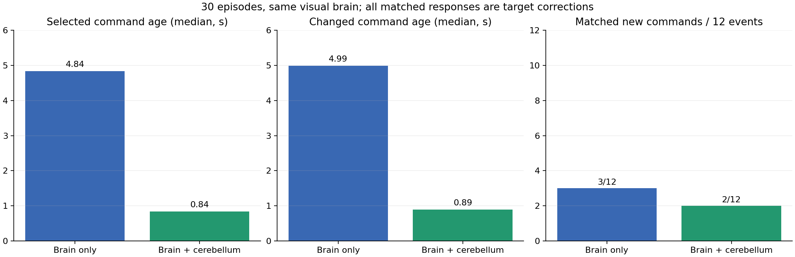
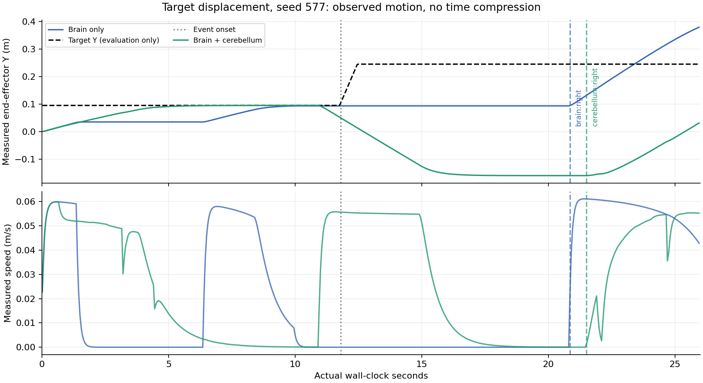

# 大脑与大脑＋小脑：速度和动作实测

本轮比较 `vlm`（纯视觉大脑）与 `vlm_omni`（同一视觉大脑＋OmniJev）。两组都有继续、刹停、退让、抬起和左右修正能力，使用同一大脑提示词模板与连续请求策略。模型权重固定。完整方法见[实验设计](brain-comparison-design.md)。

最终数据为修正保持控制器后的 **30 轮、15 对**：seeds 541、577、613；每轮 26 秒；无干扰、近手、自由物体横穿、短暂遮挡、目标突移各三对。按 seed 交换组别顺序，条件与阈值在配对实验中冻结。

## 结果

| 指标 | 纯视觉大脑 | 大脑＋小脑 |
|---|---:|---:|
| 实际选用命令：采集到应用中位 | 4.84 s | 0.84 s |
| 产生动作转换的命令：采集到应用中位 | 4.99 s | 0.89 s |
| 软件过期保持占控制时间 | 33.03% | 2.26% |
| 目标移动方向匹配的新动作 | 3/3 | 2/3 |
| 近手、横穿、短遮挡的匹配新动作 | 0/9 | 0/9 |
| 最终到目标 | 1/15 | 2/15 |

前两项由动作仲裁重放计算，包含组合组 54 次缓存答复重新生效；重放与全部 15,600 个实际控制 tick 的动作、来源和速度倍率一致。它们包含继续、恢复和修正等命令，不能当作条件识别准确率。小脑批次未触发条件时也可继续已有任务意图；“来源为小脑”说明运行时采用了该批次的门控结果，不意味着发生了正向反射触发。组合组 84 次动作转换中，24 次为条件门控触发的小脑非继续动作。

组合组的小脑返回 **602** 次、接口错误 **0**，接受 **551** 次，其中 **327** 次在答复到达的控制 tick 被采用、**52** 次当时产生动作转换；这是到达时的统计，与上面的缓存重放口径不同。小脑请求耗时中位 **0.645 s**；到达即采用的小脑命令采集到应用中位 **0.787 s**。纯组／组合组的大脑分别返回 79／81 次，错误 3／2 次，推理耗时中位 4.75／4.81 秒。物理实时因子为 **0.999645–0.999996**，推理期间没有暂停世界。

这批数据能看到更频繁的命令更新和更少的软件等待，但没有证明正确事件反应更快。无外界干扰的控制区间中，非继续、非软件保持动作占比为纯组 **28.46%**、组合组 **47.18%**；这类干预还需逐项判断是否必要，不能把动作多当成能力强。

## 事件速度与实际运动

所有匹配新动作均出现在目标移动场景。下表的事件后延迟包含等待新观察、模型判断和动作应用；它与单次采集到命令的年龄不同。

| seed | 纯大脑：事件后新动作 | 组合组：事件后新动作 | 组合组来源 |
|---|---|---|---|
| 541 | left，9.38 s | 未记录到匹配新动作 | — |
| 577 | right，9.04 s | right，9.69 s | 小脑 |
| 613 | right，5.74 s | right，8.89 s | 小脑缓存答复重新生效 |

例如 seed 577 中，小脑那次命令的采集到应用仅 **0.986 s**，但从事件开始到首次匹配新动作是 **9.69 s**。快速返回与及时作出合适的新动作是两件事。这里的匹配按预先规定的事件方向与动作转换计算，不自动证明动作相对当时视觉误差最优；已有保持、提前修正和重复同一动作不计作新反应。

大脑还可以直接更新目标点而保持动作名称不变。这部分另行评价：事件后计划点距当时真实目标平面位置小于 4 cm，纯组 **3/3**，组合组 **1/3**；纯组首次正确目标计划的事件后延迟为 9.38、9.04、5.74 秒，组合组只有 seed 613，9.14 秒。评价真值不进入模型或控制器。

原始新答复应用日志中，命令后达到预设机械运动标准的事件为纯组 3 个（seeds 541、577、613）、组合组 2 个（seeds 577、613），均为目标修正。seed 613 组合组的缓存小脑命令先在 21.05 秒生效，大脑新答复在 21.30 秒应用；新答复分析以后一条为观察起点，不能据此将运动单独归因于大脑。标准为相应方向位移达到 5 mm，且连续三个控制 tick 满足该阈值；刹停还要求先前确在运动，再满足速度下降条件。期间可能有缓存切换、后续命令和接触，因此这是命令后的测量关联，不能把随后运动全部归因给第一个模型。

- [seed 577 完整双栏视频](../results/brain_cerebellum_hold_verified_20261014/comparison_target_jump_seed577.mp4)
- [seed 613 完整双栏视频](../results/brain_cerebellum_hold_verified_20261014/comparison_target_jump_seed613.mp4)
- [全部十五段视频及参数](../results/brain_cerebellum_hold_verified_20261014/videos.json)

双栏视频顶部列出重放得到的首次匹配新命令。原始单栏画面底部的 `reaction` 字段记录最近一次新答复引起的动作转换，未按事件类别筛选，也不包含缓存重新生效；它可能随后更新，不能用作首次事件响应时间。

## 控制器修正与版本边界

交互验收发现旧保持实现每个 tick 都将关节参考点改为当前位置，导致无外部接触时持续下沉；独立机械检查在 8 秒内测到约 9.93 cm 位移。本版冻结已有参考点，保留位置伺服对静态负载的抵抗。35 项机制检查通过，包括刹停和软件保持各持续 8 秒、末端位移小于 5 mm 的回归检查。

上面的结果全部来自修正后完整复跑。修正前 30 轮、六轮接口试跑和其源码快照分别保存在 `brain_cerebellum_before_hold_20261014`、`brain_cerebellum_pilot_20261014`；不与最终统计合并。修正前的小脑接口有 163/279 次错误，最终批次为 0/602；不同时间批次的接口状态也发生了变化，不能把这个差异归因于保持控制器修正。

## 复核材料与结论

- [实际命令选择重放](../results/brain_cerebellum_hold_verified_20261014/selection_metrics.json)、[新答复应用指标](../results/brain_cerebellum_hold_verified_20261014/metrics.json)、[目标计划与迟到命令](../results/brain_cerebellum_hold_verified_20261014/motion_metrics.json)、[逐轮汇总](../results/brain_cerebellum_hold_verified_20261014/summary.json)。
- [执行命令与源码身份](../results/brain_cerebellum_hold_verified_20261014/manifest.json)、`source_snapshot/`、`analysis_source/`、每轮原始 API、JPEG 哈希、状态和电机应用记录。
- [运行说明](reflex.md)、[下载与复跑](release-v0.2.0.md)。测试中的固定答复只核验机制，不作为模型能力证据。

当前实现已经能比较两个模型层级的速度和实际运动。结果支持快速更新通道的存在，但条件判断、动作协调和任务完成率仍弱，尚不能据此确认稳定的人类式条件反射。它是有限刚体、固定相机和有界动作下的实测，也包含网络与服务端差异，不能当作模型纯算力或全部生活情境的结论。
