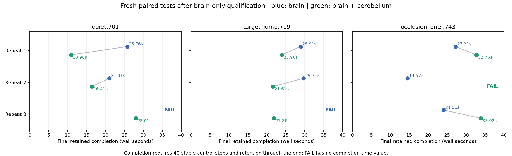

# 已验证案例上的大脑与小脑比较

先验证纯视觉大脑能够完成具体案例，再测加入 OmniJev 后的任务结果。模型权重固定。完成指到达目标、实测速度足够低、连续保持 40 个 20 Hz 控制步，并持续到本轮结束；目标移动与遮挡后的恢复另行计时。方法见[实验设计](qualified-cases-design.md)。

## 纯大脑初筛

五个候选各独立运行三次，每轮 36 秒。全部通过才入选；组合组结果不参与筛选。

| 案例 | 纯大脑初筛 | 是否入选 |
|---|---:|---|
| 静态目标 `quiet:701` | 3/3 | 是 |
| 目标移动 `target_jump:719` | 3/3 | 是 |
| 短遮挡 `occlusion_brief:743` | 3/3 | 是 |
| 短遮挡 `occlusion_brief:709` | 2/3 | 否 |
| 近手干扰 `hand_close:751` | 2/3 | 否 |

初筛共 15 轮，全部记录保留。随后冻结三个入选案例、源码、驱动、模型标识和成功标准，重新运行每组每例三次，共 **18 轮、9 对**。初筛成绩没有混入正式对照组。

## 正式结果

| 案例 | 纯大脑稳定完成 | 大脑＋小脑稳定完成 | 双方成功配对中的时间差中位数 |
|---|---:|---:|---|
| 静态目标 | 2/3 | 3/3 | 组合组早 **9.70 s** |
| 目标移动 | 2/3 | 3/3 | 组合组早 **6.53 s** |
| 短遮挡恢复 | 3/3 | 2/3 | 组合组晚 **7.70 s** |
| 合计 | **7/9** | **8/9** | 不将失败换算成速度 |

每行只有两对双方均成功的运行可计算时间差。其余失败仍留在成功率分母中。上表比较的是最终持续保持区间达到成功要求的墙钟时间，不是接口返回速度，也不是第一次进入目标区域的时间。

| 案例 | 重复 | 纯大脑稳定完成时间 | 组合组稳定完成时间 |
|---|---:|---:|---:|
| 静态目标 | 1 | 25.76 s | 10.96 s |
| 静态目标 | 2 | 21.01 s | 16.41 s |
| 静态目标 | 3 | 未通过 | 28.01 s |
| 目标移动 | 1 | 28.91 s | 23.96 s |
| 目标移动 | 2 | 29.71 s | 21.61 s |
| 目标移动 | 3 | 未通过 | 21.86 s |
| 短遮挡 | 1 | 27.21 s | 32.76 s |
| 短遮挡 | 2 | 14.57 s | 未通过 |
| 短遮挡 | 3 | 24.06 s | 33.92 s |

时间均从本轮启动计算。目标移动后的恢复时间，在成功运行中中位数为纯组 16.65 秒、组合组 9.20 秒；短遮挡结束后的恢复中位为 11.45 秒、20.73 秒。由于两组成功次数不同，这些分组中位数是描述统计；配对速度差使用上表双方成功的同一次重复。

## 速度差意味着什么

这轮已经有可以完成的基线：静态目标和目标移动中，组合组在两个双方成功的配对里都更早稳定完成；短遮挡中两个配对都更晚完成，且多一次未达到稳定保持标准。因此，当前实现有情境相关的收益，也有明确反例。

首次到达和持续保持需要分开看。静态目标第一次正式配对中，纯组第一次连续低速保持达标是 11.41 秒，组合组为 10.96 秒，差距约 0.45 秒。纯组之后更新目标和纠偏，最终持续保持的完成时间推迟到 25.76 秒。不能把最终 14.80 秒的差距说成机械臂从起点到目标的运动快了 14.80 秒。

运行记录显示，组合组的软件过期保持占控制时间约 3.26%，纯组约 37.81%。但是两组收到的后续图像、反馈、视觉大脑目标点与调用耗时也不同。它们是闭环系统的实测差异，三次重复不足以把每一秒收益单独归因于小脑的条件判断，更不能外推为通用条件反射理论已经成立。

## 失败与限制

- 纯组静态目标第三次：终点误差 3.70 cm，最终低速保持只有 1.0 秒，未满足预设标准。
- 纯组目标移动第三次：终点误差 11.56 cm，未回到目标范围。
- 组合组短遮挡第二次：终点误差 2.02 cm，但最终低速保持只有 1.4 秒，未满足预设标准。

如果只看最后一帧是否在目标范围，纯组为 8/9、组合组为 9/9；本报告始终使用更严格的连续稳定完成标准。初筛 3/3 并不保证独立复测全成功，正式失败没有重跑替换。

视觉大脑接口错误分别为纯组 3 次、组合组 4 次。组合组 OmniJev 返回 493 次，接口错误 0 次。物理实时因子为 0.9999947–0.9999975；模型等待期间世界继续运行。全部正式配对人手／物体接触峰值均为零，这批合格案例不能用于证明减少碰撞的能力；近手候选尚未通过纯大脑筛选。

这些是三个精确 seed 情境的重复结果，尚不是跨任务、跨环境的泛化结果。仿真使用有限刚体、固定相机和有界控制。

## 视频、源码与复核

- [目标移动第 1 对完整视频](../results/qualified_paired_20261014/comparison_target_jump_seed719_repeat1.mp4)
- [静态目标第 1 对完整视频](../results/qualified_paired_20261014/comparison_quiet_seed701_repeat1.mp4)
- [遮挡第 1 对完整视频](../results/qualified_paired_20261014/comparison_occlusion_brief_seed743_repeat1.mp4)
- [全部九段视频及哈希](../results/qualified_paired_20261014/videos.json)、[完整统计](../results/qualified_paired_20261014/task_comparison.json)、[逐轮结果](../results/qualified_paired_20261014/summary.json)、[冻结资格清单](../results/qualified_paired_20261014/qualification_frozen.json)。
- [首批初筛](../results/qualified_screen_20261014/summary.json)、[补充初筛](../results/qualified_screen_extra_20261014/summary.json)、[复跑说明](release-v0.3.0.md)。

筛选和配对期间运行源码、实验驱动和模型策略相同。每批包含执行源码快照和全部 API、画面、状态及动作记录。39 项机制检查在初筛前通过；交付前增加交互重置回归，共 40 项通过。

实验结束后只修正交互重置使用的自身初始位置、最终 PNG 的动作来源等显示字段，并让交互页面显示稳定完成判定。正式实验不调用交互重置；AST 比较确认其它物理控制及评分逻辑保持相同。[交付与执行源码身份](../results/qualified_ui_20261014/manifest.json)保留差异。原始实验的 `final.png` 有空来源／默认脑状态文字，实际动作来源应查完整视频与状态日志；原始文件保留。
